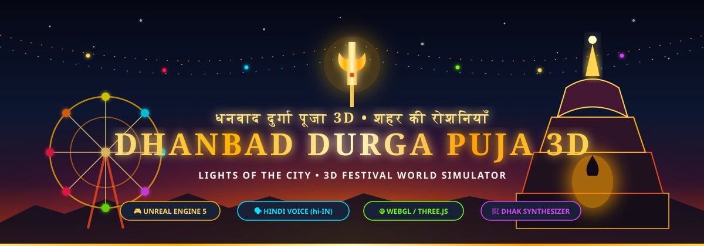
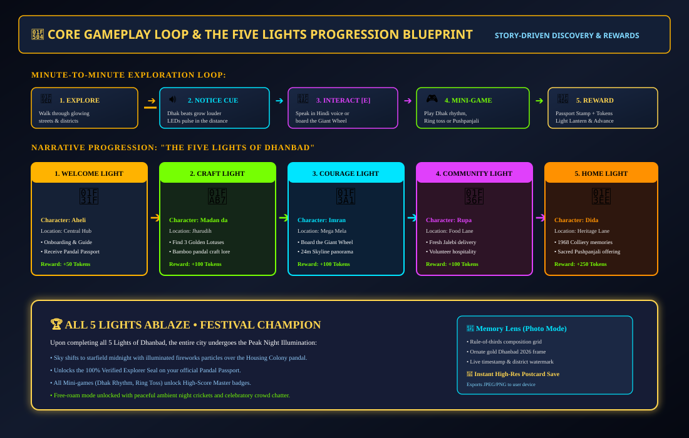

# Dhanbad-Durga-Puja-3D-Lights-of-the-City

<div align="center">



# 🪔 DHANBAD DURGA PUJA 3D: LIGHTS OF THE CITY
### 3D Festival World Simulator & Exploration Adventure • धनबाद दुर्गा पूजा 3D: शहर की रोशनियाँ

[](https://www.unrealengine.com/)
[](https://threejs.org/)
[-E64A19?style=for-the-badge&logo=google-translate&logoColor=white)](https://developer.mozilla.org/en-US/docs/Web/API/Web_Speech_API)
[](https://developer.mozilla.org/en-US/docs/Web/API/Web_Audio_API)
[](https://vitejs.dev/)

<p align="center">
  <b>A respectful, exploration-first 3D festival simulator set in Dhanbad, Jharkhand during Durga Puja.</b><br/>
  Walk illuminated streets from dusk to midnight, witness majestic pandals, ride the 24m Giant Wheel, enjoy live Hindi voice dialogues, play the Dhak rhythm challenge, offer Pushpanjali in the sanctum, and restore <i>The Five Lights of Dhanbad</i>.
</p>

[🎮 Play Live Demo](http://localhost:3000/) • [🗺️ World Topology](#-world-map--district-topology) • [⚙️ Technical Architecture](#-technical-architecture--runtime-systems) • [🔄 Gameplay Loop](#-gameplay-loop--the-five-lights) • [🕹️ Controls](#-controls-guide)

</div>

---

## 🌟 Executive Overview & Key Features

* **Authentic Dhanbad Festival Setting:** Explore a stylized, connected hub-and-spoke reconstruction inspired by Dhanbad’s iconic neighbourhoods: **Central Festival Hub**, **Housing Colony Pandal**, **Mega Mela Fairground**, **Jharudih Craft Lane**, and **Purana Bazar / Heritage Lane**.
* **The Festival Pulse (Dynamic Lighting Timeline):** Dynamic time-of-day progression from warm dusk (**16:30**) through blue hour (**17:30**) to the peak night illumination (**19:30 - 23:00**), with real-time celestial lighting, volumetric fog, and fairy light bloom.
* **🗣️ Native Hindi Voice Narration (`hi-IN`):** Powered by the Web Speech API, every character (**Aheli**, **Madan da**, **Imran**, **Rupa**, **Dida**) speaks their dialogue lines aloud in natural Hindi with unique pitch and personality, accompanied by authentic fairground loudspeaker PA broadcasts!
* **🥁 Procedural Bengali Dhak Synthesizer:** Real-time Web Audio API percussive synthesis producing traditional *Dha-tin-tin-na* beats and brass *Kanshi* bell chimes with dynamic 3D spatial distance attenuation.
* **🎡 Interactive Mega Mela & Attractions:** Board the 24m Giant Wheel (Jhula) for a breathtaking high-altitude skyline panorama, take a ride on the Carousel, test your skills at the Ring Toss stall, and play the Dhak Rhythm Challenge!
* **🪷 Devotional Sanctum & Pushpanjali Ritual:** Enter the sanctum of the Housing Colony Pandal, fold hands before the respectful Pratima silhouette, offer marigold petals, and listen to the sacred conch shell (*Shankha*) reverberations.
* **📸 Memory Lens (Photo Mode):** Rule-of-thirds composition grid with an ornate gold festive border, Dhanbad 2026 watermark, timestamp, and instant high-resolution postcard download to your device.

---

## 🗺️ World Map & District Topology

The game world uses a connected **hub-and-spoke spatial layout** designed so that travel between any landmark stays under **3 to 5 minutes on foot**, ensuring continuous visual reward and zero dead zones:


### District Specifications

| District / Landmark | In-Game Role | Signature Interaction | Audio & Atmosphere | Priority |
| :--- | :--- | :--- | :--- | :---: |
| **Central Festival Hub** `(0, 0, 0)` | Spawn & Information Kiosk | Meet **Aheli**; receive Pandal Passport; view festival map board | Warm dusk lanterns, crowd chatter | **P0** |
| **Illuminated Light Tunnel** `(0, 0, -32)` | Visual transitional arterial route | Walk through 14 structural arches with sequential chasing LED lights | Chasing LED hum, distant dhak | **P0** |
| **Housing Colony Pandal** `(0, 0, -62)` | Main Theme Spectacle (Hero Showpiece) | Multi-tiered Bengali Chala architecture, Alpona floor art, Brocade fabric ceiling, **Pushpanjali Ritual** at the Pratima altar | Peak Dhak reverberation, temple bells | **P0** |
| **Mega Mela & Fairground** `(45, 0, 0)` | Fairground & Amusements | **24m Giant Wheel (Jhula)** ride with panoramic camera, Carousel, Ring Toss game stall, Food Lane | Mela announcements, vendor calls | **P0** |
| **Jharudih Craft Lane** `(-40, 0, 0)` | Traditional Artisan Quarter | Speak with **Madan da**; search the courtyard for 3 misplaced **Golden Lotus** craft bundles | Wood carving, bamboo creaks | **P1** |
| **Heritage Lane & Purana Bazar** `(0, 0, 32)` | Cultural Nostalgia & Memory | Speak with **Dida**; listen to oral history of Dhanbad's colliery puja unity since 1968 | Soft evening crickets, classical sitar | **P1** |
| **Expansion Gates** | Outlying Districts | Signposted gateways toward Jharia, Sindri, Digwadih, and Pathardih | Distant train whistle, night wind | **Phase 2** |

---

## ⚙️ Technical Architecture & Runtime Systems

The simulator implements a modular, high-fidelity engine architecture compatible with modern desktop standards (Unreal Engine 5 blueprint & WebGL runtime):


### Core Architectural Subsystems

```
busy-franklin/
├── src/
│   ├── main.js                   # Application bootstrap, event wiring, and frame update
│   ├── style.css                 # Festive Indian aesthetic design system
│   ├── core/
│   │   ├── Engine.js             # Three.js WebGLRenderer, PCFSoftShadowMap, ACES Tonemapping
│   │   ├── InputManager.js       # WASD, Arrow keys, Orbit Cam, Touch Analog Joystick
│   │   ├── FestivalClock.js      # The Festival Pulse: 16:30 to 23:00 sky & lighting curve
│   │   ├── AudioDirector.js      # Procedural Web Audio API Dhak & Kanshi synthesis
│   │   ├── HindiVoiceDirector.js # Web Speech API (hi-IN) voice narrator & PA announcer
│   │   ├── Localization.js       # Bilingual Hindi (Devanagari) & English string tables
│   │   └── SaveManager.js        # LocalStorage versioned state with checksums
│   ├── world/
│   │   ├── WorldBuilder.js       # Ground terrain, roads, artisan lane, collectibles
│   │   ├── CentralHub.js         # Welcome Toran arch, marigold garlands, info kiosk
│   │   ├── LightTunnel.js        # 40-meter arched dynamic chasing LED light matrix
│   │   ├── HousingColonyPandal.js# Multi-tier pandal, sanctum dais, Pratima, diyas, smoke
│   │   ├── MegaMela.js           # 24m Giant Wheel (Jhula), Carousel, food stalls, game booth
│   │   ├── CrowdDirector.js      # 3-tier crowd simulation with RVO local avoidance
│   │   └── TextureGenerator.js   # Procedural canvas Alpona, brocade fabrics, signboards
│   ├── entities/
│   │   ├── Player.js             # 3rd-person avatar with procedural walk/run/jump cycles
│   │   └── NPC.js                # Authored NPCs: Aheli, Madan da, Imran, Rupa, Dida
│   ├── gameplay/
│   │   ├── QuestManager.js       # The Five Lights story graph and chapter progress
│   │   ├── RideSystem.js         # Ferris wheel ride state machine & scenic orbit camera
│   │   └── MiniGames.js          # Dhak Rhythm Challenge, Ring Toss, and Pushpanjali ritual
│   └── ui/
│       ├── HUD.js                # Minimap radar, objective cards, stats, and prompts
│       ├── DialogueBox.js        # Branching dialogues with live Hindi speech synthesis
│       ├── PassportModal.js      # Official Pandal Passport with verified stamp seals
│       ├── PhotoMode.js          # Memory Lens viewfinder with postcard export
│       └── SettingsModal.js      # Time slider, volume, crowd density, reduced motion
```

---

## 🔄 Gameplay Loop & The Five Lights

The game loop is exploration-first: players are never forced into combat or arbitrary time pressure. The core reward is discovery, human connection, and festival atmosphere:



### The Five Lights of Dhanbad

1. **🌟 The Welcome Light (स्वागत दीप):**
   * **Guide:** Aheli at the Central Festival Hub
   * **Mission:** Learn about Dhanbad's festive history, receive the official Pandal Passport, and discover the Housing Colony Pandal.
   * **Reward:** +50 Festival Tokens, Central Hub Stamp.
2. **🪷 The Craft Light (शिल्प दीप):**
   * **Guide:** Madan da at Jharudih Craft Lane
   * **Mission:** Search the artisan workshop courtyard to recover 3 misplaced **Golden Lotus** ornaments.
   * **Reward:** +100 Festival Tokens, Jharudih Craft Court Stamp.
3. **🎡 The Courage Light (साहस दीप):**
   * **Guide:** Imran at the Mega Mela
   * **Mission:** Board the 24m Giant Wheel (Jhula), ascend to the summit, and witness the panoramic city lights.
   * **Reward:** +100 Festival Tokens, Mega Mela Stamp.
4. **🍯 The Community Light (मिठास दीप):**
   * **Guide:** Rupa at the Food Lane
   * **Mission:** Collect a box of fresh, hot festive jalebis and share community sweetness with volunteer desks.
   * **Reward:** +100 Festival Tokens, Community Service Seal.
5. **🏮 The Home Light (गृह दीप):**
   * **Guide:** Dida at Heritage Lane & Purana Bazar
   * **Mission:** Listen to the oral history of coalfield unity since 1968, then enter the Housing Colony sanctum to offer **Pushpanjali**.
   * **Reward:** +250 Festival Tokens, Housing Colony Pandal Stamp, Golden Festival Trophy!

---

## 🕹️ Controls Guide

| Action | Desktop (Keyboard & Mouse) | Mobile & Touch Devices |
| :--- | :--- | :--- |
| **Move** | `W`, `A`, `S`, `D` or Arrow Keys | Virtual Analog Joystick (bottom-left) |
| **Sprint / Jog** | Hold `Shift` | Auto-run / Fast drag |
| **Jump** | `Space` | On-screen `JUMP` Button |
| **Orbit Camera** | Click & Drag Mouse | Drag across screen |
| **Interact / Talk / Board / Play** | **`E`** Key | On-screen **`E`** Touch Button |
| **Toggle Language (हिन्दी / EN)** | Click **`[🌐]`** in header | Tap **`[🌐]`** in header |
| **Toggle Hindi Voice Narration** | Click **`[🗣️]`** in header | Tap **`[🗣️]`** in header |
| **Open Memory Lens (Photo Mode)** | **`P`** Key or Camera Icon | Tap Camera Icon |
| **Open Pandal Passport** | **`J`** Key or Passport Icon | Tap Passport Icon |
| **Toggle Dhak Sound** | **`M`** Key or Sound Icon | Tap Sound Icon |
| **Settings & Clock Slider** | **`O`** Key or Gear Icon | Tap Gear Icon |

---

## 🚀 Installation & Quick Start

Ensure you have **Node.js** (v18+) and **npm** installed.

```bash
# 1. Clone the repository
git clone https://github.com/Ranjeet7680/Dhanbad-Durga-Puja-3D-Lights-of-the-City.git

# 2. Navigate to the project directory
cd Dhanbad-Durga-Puja-3D-Lights-of-the-City

# 3. Install dependencies
npm install

# 4. Start local development server
npm run dev
```

Open your browser at **`http://localhost:3000/`** to enter the festival!

### Building for Production

```bash
# Compile and optimize production bundle into /dist
npm run build

# Preview production build locally
npm run preview
```

---

## 🕊️ Cultural Respect, Safety & Permissions

* **Devotional Integrity:** Sacred elements (such as the *Pratima* tableau and inner sanctum) are depicted with deep respect as devotional focal points. The game contains zero combat, vandalism, or disrespectful actions.
* **Fictionalized Geographic Adaptation:** Real Dhanbad landmarks (Housing Colony, Railway Ground, Jharudih, Bank More, Purana Bazar) serve as design inspiration for this celebration. The in-game map is a stylized cultural interpretation.
* **Offline-First & Privacy Preserving:** The entire game runs client-side. No GPS tracking, microphone recordings, or personally identifiable data are collected.

---

<div align="center">
  <b>🌸 शुभ शारदीया • SHUBHO SHARODIYA • HAPPY DURGA PUJA 🌸</b><br/>
  <i>Crafted with love for the people, culture, and illuminated nights of Dhanbad.</i>
</div>
